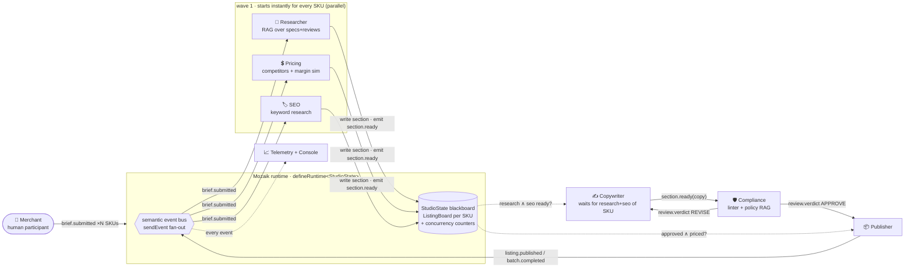
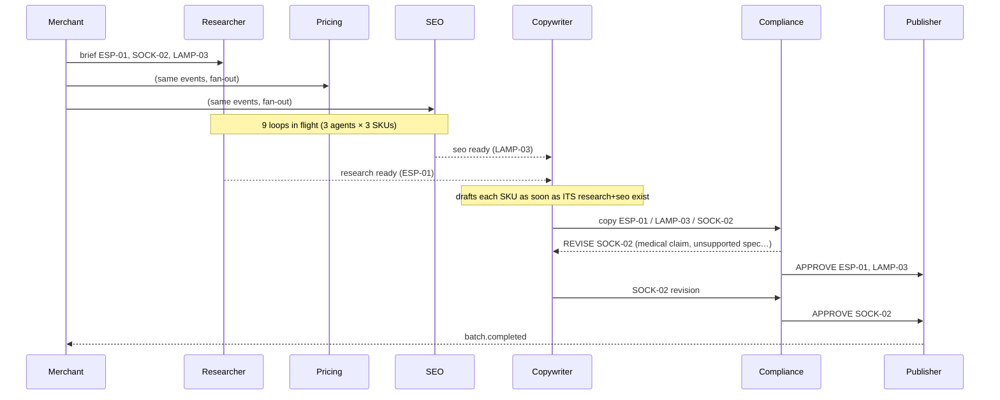

# 🧩 ListingSwarm — a concurrent multi-agent listing studio on Mozaik

> **JigJoy NTP Novi Sad Hackathon · Freestyle track** · TypeScript · [`@mozaik-ai/core`](https://www.npmjs.com/package/@mozaik-ai/core) 4.2

A merchant drops a batch of product SKUs. A swarm of **five Mozaik agents** then turns them into
marketplace-ready listings: researched, priced, SEO-optimised, written, and **compliance-checked**.
The agents run **concurrently** on one shared Mozaik runtime and coordinate only through
**semantic events plus a shared blackboard state**. There is no central orchestrator: every agent
decides on its own when it has enough information to act.

```
3 SKUs in → 9 agent loops in flight at t=0 → drafts → critiques → revisions → 3 published listings
LIVE run (MiniMax-M2.7): 19 loops, 61 model calls, 42 tool calls, 89 s wall-clock vs 232 s of agent work (2.6× parallelism)
```

## Why it's useful

Writing a good product listing is a team sport. Someone reads the specs and the reviews, someone
checks competitor prices and margins, someone finds keywords, someone writes, and someone makes sure
the copy doesn't promise things that get the listing taken down (*"#1 rated"*, *"cures blisters"*,
*"100% leak-proof"*). ListingSwarm models that team as agents. The product data even ships
**policy-violating merchant claims** on purpose, so you can watch the Compliance agent catch them and
send the Copywriter back for a revision.

## Features

- **5 collaborating LLM agents + 4 non-LLM participants** on a single `defineRuntime<StudioState>()`
  runtime.
- **True parallelism:** Researcher, Pricing, and SEO start the moment a brief appears, for **every SKU
  at once** (3 × 3 = 9 concurrent Mozaik `runLoop`s). Copywriter and Compliance loops fan in per SKU
  as soon as that SKU's prerequisites land on the board, so SKU A can be in review while SKU B is
  still being researched.
- **Shared state (blackboard):** `StudioState extends RuntimeState` holds one `ListingBoard` per SKU
  (research, pricing, seo, copy, review history, approval) and live concurrency counters. Agents
  read each other's work from it and publish `section.ready` events when they write.
- **Critique → revision loop between agents:** Compliance returns `REVISE` with concrete issues, the
  Copywriter revises (up to `MAX_REVISIONS`), and Compliance re-reviews.
- **RAG:** a BM25 index over product specs, customer reviews, and the marketplace policy
  (`search_knowledge_base`, `search_policies`). Agents cite the chunks they used.
- **8 real function tools:** spec lookup, review stats, competitor prices, a price/margin simulator
  (15% marketplace fee), keyword research, a deterministic policy linter, and the two RAG searches.
- **Guardrails:** the deterministic linter (`src/lint.ts`) has **veto power** over the LLM's verdict,
  so an LLM can't wave through "#1 rated".
- **Observability:** a Telemetry participant records every event (`out/events.jsonl`) and every
  loop's start, end, inference count, and tool calls. It prints a **concurrency Gantt chart**, peak
  concurrent loops and model calls, and the parallel speed-up, and writes `out/run-report.md` with a
  mermaid timeline.
- **Runs anywhere:** a **no-key mock mode** (a scripted `InferenceRunner` that still drives *real*
  Mozaik loops and *real* tool calls), any OpenAI-compatible endpoint, MiniMax, or Mozaik's built-in
  OpenAI, Anthropic, and Gemini providers.
- **Robust live mode:** bounded inference parallelism, retry with backoff, `<think>`-tag stripping,
  JSON repair, plus a self-repair loop if a model answers in invalid JSON. Loop errors never crash the
  run.

## Quick start

Requires **Node ≥ 20**.

```bash
git clone https://github.com/qinheyi/mozaik-listing-swarm.git
cd mozaik-listing-swarm
npm install

# 1) No API key needed: mock inference, but real Mozaik runtime, loops, events and tools (~12 s)
npm run demo

# 2) Live LLM: pick any ONE of these
export LLM_BASE_URL=https://openrouter.ai/api/v1 LLM_API_KEY=sk-... LLM_MODEL=openai/gpt-4o-mini   # any OpenAI-compatible API
export MINIMAX_API_KEY=...                       # MiniMax-M2.7 (what the sample run used)
export OPENAI_API_KEY=sk-...                     # or ANTHROPIC_API_KEY / GEMINI_API_KEY (Mozaik built-in providers)
npm start
```

(Or `cp .env.example .env` and fill it in; `.env` is loaded automatically.)

Options:

| flag / env | meaning |
|---|---|
| `--mock` / `MOZAIK_MODE=mock` | force mock mode |
| `--skus=ESP-01,LAMP-03` | process only these SKUs (default: all in `data/products.json`) |
| `--verbose` | also log each inference start |
| `MAX_REVISIONS` (2) | max Copywriter↔Compliance revision rounds |
| `MAX_PARALLEL_INFERENCES` (12) | cap on simultaneous model calls (rate-limit friendly) |
| `LLM_MODEL` | override the model name for any provider |
| `MOZAIK_API_KEY` | optional: stream traces to Mozaik Cloud |

If no key is found, `npm start` falls back to mock mode and prints a warning.

**Outputs** (in `out/`): `listings/<SKU>.md|.json` (the final listings, including "how the team got here":
review rounds and pricing rationale), `events.jsonl` (every runtime event), and `run-report.md`
(stats plus a mermaid Gantt chart of the agent loops).

`npm run typecheck` type-checks the project.

## Architecture



**Event-driven, no orchestrator.** Every participant is a Mozaik `Participant` (agents via
`createAgent`, the merchant via `createHuman`) joined to the runtime. Each one registers
`SituationHandler`s: a `SituationSpecification` (e.g. `EventIs("section.ready", p => p.section === "research")`)
plus a processor. When `sendEvent` fans an event out, each handler that matches starts a new
**Mozaik agent loop** (`runLoop(agentId, message, {model, context, tools}, interceptionHandler)`).
`runLoop` is fire-and-forget, so many loops for many agents and SKUs are in flight on the same
runtime at the same time. Each loop:

1. gets a **fresh `ModelContext`** seeded with the agent's instruction, so the same agent can work on
   three SKUs at once without their conversations mixing;
2. runs Mozaik's state machine: inference → function calls (the agent's tools) → inference → … → model answer;
3. is observed through an `InterceptionHandler` on the `model_message` transition, which writes the
   answer into that SKU's section of the shared `StudioState` and emits `section.ready` /
   `review.verdict`, waking whoever is waiting for it.

| participant | kind | reacts to | tools | writes |
|---|---|---|---|---|
| Merchant | human | – | – | `brief.submitted` |
| Researcher | agent | `brief.submitted` | get_product_spec, search_knowledge_base, review_stats | `board.research` |
| Pricing | agent | `brief.submitted` | get_competitor_prices, simulate_price | `board.pricing` |
| SEO | agent | `brief.submitted` | keyword_research | `board.seo` |
| Copywriter | agent | `section.ready` (research/seo) when both present; `review.verdict` REVISE | search_knowledge_base | `board.copy` |
| Compliance | agent | `section.ready` (copy) | lint_listing, search_policies | `board.reviews`, `review.verdict` |
| Publisher | participant | `review.verdict`, `section.ready` (pricing) | – | `out/listings/*`, `listing.published`, `batch.completed` |
| Telemetry / Console | participants | every event + loop events | – | `out/events.jsonl`, metrics, live feed |

### How the agents run concurrently (from a real live run)



The sample live run's Gantt (`examples/live-minimax/console.txt`):

```
Researcher ESP-01  research  |████████                                                    | 11.6s
Pricing    ESP-01  pricing   |████████                                                    | 10.7s
SEO        ESP-01  seo       |████                                                        | 4.8s
Researcher SOCK-02 research  |██████████                                                  | 14.5s
Pricing    SOCK-02 pricing   |██████████████████                                          | 26.8s
SEO        SOCK-02 seo       |████                                                        | 5.5s
Researcher LAMP-03 research  |██████████                                                  | 14.2s
Pricing    LAMP-03 pricing   |███████                                                     | 9.9s
SEO        LAMP-03 seo       |███                                                         | 4.4s
Copywriter ESP-01  draft     |       █████                                                | 5.9s
Copywriter LAMP-03 draft     |         ███████                                            | 8.4s
Copywriter SOCK-02 draft     |         ███████                                            | 7.9s
Compliance ESP-01  review#0  |           █████████████████                                | 23.2s
Compliance SOCK-02 review#0  |               ███████████                                  | 16.1s
Compliance LAMP-03 review#0  |               ████████████                                 | 16.8s
Copywriter SOCK-02 revise#1  |                         ██████████                         | 13.6s
Compliance SOCK-02 review#1  |                                  ████████████              | 15.9s
Copywriter SOCK-02 revise#2  |                                             ████████       | 10.8s
Compliance SOCK-02 review#2  |                                                    ████████| 10.7s

mode                 : LIVE MiniMax-M2.7 @ https://api.minimaxi.com/v1
agent loops          : 19  (model calls: 61, tool calls: 42, events: 336)
peak concurrent loops: 9   peak concurrent model calls: 9
wall-clock           : 89.4s   vs. sequential agent time 231.6s  →  2.6x parallelism
```

## Sample output

- [`examples/live-minimax/`](examples/live-minimax): a full **live LLM run**: console log, run report
  with mermaid Gantt, and the three published listings.
- [`examples/mock-demo/`](examples/mock-demo): what `npm run demo` prints.

Excerpt of a published listing (`examples/live-minimax/SOCK-02.md`). Compliance rejected two
drafts (a medical "blister" claim, and a fibre-blend detail it could not find in the research) before
approving:

```text
# Merino Wool Hiking Socks 3-Pack — 23 cm Crew, Medium Cushioning for Men & Women
SKU: SOCK-02 | Price: $31.49 | Margin: 0.406 | Positioning: value
- Medium cushioning under foot, heel and toe — a buyer called it perfect for long descents with no hot spots in boots
- Built-in arch support band keeps the sock from sliding down during long treks
...
What to expect: sizing runs large ... Toe durability is limited ...
## How the team got here
- Compliance rounds: round 0: REVISE (2 issues); round 1: REVISE (7 issues); round 2: APPROVE
```

## Project structure

```
src/
  index.ts         CLI entry: picks the LLM, initialises the runtime, joins participants, prints the report
  runtime.ts       defineRuntime<StudioState>, shared blackboard, domain events, situation specs
  agents.ts        the 5 LLM agents (instructions, handlers, loop launching, JSON parsing/self-repair)
  participants.ts  Merchant (human), Publisher, Telemetry, Console feed
  tools.ts         8 FunctionTools with strict JSON schemas
  kb.ts            data loading + BM25 retrieval over specs, reviews and policy
  lint.ts          deterministic marketplace-policy linter (veto guardrail)
  llm.ts           provider resolution, OpenAI-compatible endpoint, SafeRunner (limits/retries), model router
  mock.ts          MockInferenceRunner: scripted, tool-calling, no key
data/              products, reviews, competitors, keywords, policies.md (bring your own SKUs!)
examples/          sample live + mock runs
```

Add your own products by appending to `data/*.json` (the keys are documented by the existing entries).

## Team & track

- **Track:** Freestyle
- **Team:** solo, qinheyi

MIT licensed.
